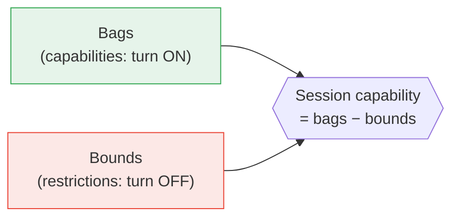

# Quick Start: A Layered Guide to Barry

This guide gives you Barry's model in layers, from one sentence to deep links,
plus a [glossary](#glossary) of every term. It exists because Barry's reference
docs are thorough but assume you already hold the whole model.

Read it top to bottom the first time. Come back to the [glossary](#glossary)
whenever a word stops making sense.

---

## Layer 0: Barry in one sentence

**Barry gives an AI agent a set of real, composable tools whose powers you can
grant and revoke precisely, instead of handing it a shell and hoping.**

---

## Layer 1: The one idea that explains everything

Barry has two independent dials:

- **Bags turn capabilities ON.**
- **Bounds turn capabilities OFF.**

They are *separate axes*. You don't configure "read-only mode" as a feature; you
pack the filesystem bag and then apply a `readonly` bound that withholds `*:write`
and `*:Bash`. Bags add; bounds subtract; the final power is `bags − bounds`.

Everything else in Barry is machinery that makes those two dials safe, durable,
and reusable.



---

## Layer 2: The six nouns you must know

You can be productive knowing just these. Full definitions are in the
[glossary](#glossary).

| Noun | One-liner | Think of it as |
|---|---|---|
| **Bag** | A package of capabilities (tools, data, actions, instructions, bounds) | An app you install |
| **Bound** | A named restriction that narrows capabilities across 6 `{ allow, deny }` dimensions | A leash |
| **Identity** | A named agent config with its own bags, bounds, secrets, and defaults | A user account for an agent |
| **Session** | One run of an agent (a durable record + a live handle) | A conversation/task |
| **Action** | A reusable, defined unit of work | A saved command / a skill |
| **Instruction** | Guidance injected into the agent's prompt | A standing note to the agent |

The mental sentence that ties them together:

> An **identity** *packs* **bags**, which provide capabilities, and may apply
> **bounds**, which restrict them; a **session** runs under that identity with the
> resulting capabilities, optionally invoking **actions** and guided by **instructions**.

---

## Layer 3: The five-minute mental model

### How capabilities flow

1. You **install** a bag (system-wide) and **pack** it onto an identity (`bags:` in `identity.yaml`).
2. Bare bags in `identity.yaml` are active on every session; `optional: true` bags can be added per session (`--bag <name>`).
3. The identity (or a single session via `--bound <name>`) can apply **bounds** to narrow tools, inputs, files, bash, network, or nodes.
4. A **session** starts; Barry computes the resolved bound and filtered tool set in one pass and hands the agent exactly those tools.

### Who's driving: the three session modes

Barry can run six different agent harnesses (Claude Code, Codex, Cursor,
OpenCode, pi, Antigravity). How much control Barry has depends on the **mode**:

| Mode | Who drives | What Barry holds |
|---|---|---|
| `hosted` | Barry | everything: each event, delivery, interrupt, and a ruling on every tool call |
| `instrumented` | a human in the harness's own UI | side doors opened at launch: delivery, capture, tool gating |
| `guest` | a human in the harness's own UI | only what the harness leaves behind (its transcript) |

Rule of thumb: **`hosted` = strongest guarantees**, because Barry holds the engine
handle.

### The safety promise (and its honest fine print)

Barry's enforcement **fails closed**: if it can't tell what a tool call does, it
denies it. Denials beat allows. Harness native tools are withheld whenever a bound
restricts their dimension or denies `*:write` / `*:<ToolName>`. Built-in config
protection always guards Barry's own config files. But some guarantees are
*conditional*: for example, the network egress sandbox is only proxy-enforced on
supported harnesses and falls back to best-effort guards elsewhere. Read
[the bounds documentation](../sdk/docs/bounds.md) before relying on any one bound.

---

## Layer 4: Your first 15 minutes (hands-on)

> Platform note: real services run on **macOS** (launchd). Linux is for
> development/CI with `setup --no-start`. Requires **Node ≥ 26.9** and **pnpm 12**.
> Source: `docs/install.md`, `package.json`.

### Install (linked checkout: the primary channel)

```sh
git clone https://github.com/perintyler/barry-dev.git
cd barry-dev
pnpm install --frozen-lockfile
pnpm build:packages
node cli/bin/barry.js setup --link .
```

Setup prints the installed command's path, put its directory on your `PATH`.
(`docs/install.md`.)

### Create your first agent (identity)

```sh
barry identity create bonanza
```

### Give it a capability (pack a bag)

```sh
bonanza pack embeddings      # add the embeddings bag to this identity
```

A per-identity CLI named after your agent is generated automatically, so
`bonanza <command>` works. You can also use `barry use <identity>` to switch.

### Start a session and pick capabilities

```sh
bonanza                      # starts a session; prompts you to select bags & bounds
```

### Check health

```sh
barry doctor --json
barry service status --json
```

That's the full loop: **install → create identity → pack bag → start session**.

---

## Layer 5: Where to go deep (by goal)

| I want to… | Read |
|---|---|
| Understand the primitives precisely | `sdk/docs/bags.md`, `sdk/docs/modules.md` |
| Write restrictions correctly | `sdk/docs/bounds.md` |
| Author my own bag | `sdk/docs/bags.md` ("Installing a bag"), `sdk/README.md` |
| Add or understand a harness | `adapters/README.md` |
| Run durable background work | `sdk/docs/workflows.md`, `sdk/docs/workflows-runbook.md` |
| Link other machines as workers | `sdk/docs/distributed-work.md`, `sdk/docs/distributed-trust.md` |
| Install / upgrade / uninstall | `docs/install.md`, `docs/support.md` |

### Suggested reading order for a new contributor

1. This guide (Layers 0 through 4).
2. `sdk/docs/bags.md` then `sdk/docs/bounds.md`, the authoring surface.
3. `sdk/docs/modules.md`, the module-ownership map, once the nouns are familiar.
4. The subsystem doc for whatever you're about to touch.

---

## Glossary

Alphabetical. Each entry notes the authoritative source.

**Action**: A named, reusable unit of work with defined inputs; Barry's take on
"skills." Runs can be triggered now, scheduled, or invoked by a session.
*(`sdk/src/actions/`, `bags/actions/`.)*

**Adapter**: A package that teaches Barry how to use an external vendor. Four
kinds: **session** adapters (agent harnesses like Claude Code), **completion**
adapters (single-turn model calls), **embedding** adapters, and **decision**
adapters. Added with `barry adapter add <path>`. *(`adapters/README.md`.)*

**ACP (Agent Client Protocol)**: An open protocol Barry speaks both inward (host
any ACP harness) and outward (serve Barry to editors like Zed). *(`sdk/src/acp/`,
`adapters/README.md`.)*

**Bag**: A capability package. May contain tools/MCP servers, a SQLite store,
actions, skills, instructions, schedules, apps, vault items, bounds, jobs, and even nested
bags. The unit you install and pack. A bag with only declarations (bounds,
constants) needs no code. *(`sdk/docs/bags.md`, `sdk/src/bags/manifest.ts`.)*

**Bound**: A restriction that *narrows capability* across six `{ allow, deny }` dimensions:
`tools`, `inputs`, `files`, `bash`, `network`, and `nodes`.
Denials union; allowlists preserve every bound's clause; a deny always wins. *(`sdk/docs/bounds.md`,
`sdk/src/bounds/`.)*

**Egress sandbox**: A hostname-filtering network proxy (`network.enforce:
sandbox`) that the agent cannot lift. Only enforced on supported harnesses;
elsewhere it degrades to best-effort guards with a diagnostic. *(`sdk/docs/bounds.md`.)*

**Fails closed**: The design rule that ambiguity results in denial: unreadable
command or path under an active bound → deny. *(`sdk/src/bounds/bound-guards.ts`, `sdk/docs/bounds.md`.)*

**Harness**: The actual agent program a session runs (Claude Code, Codex, Cursor,
OpenCode, pi, Antigravity). Provided by a session adapter. *(`adapters/sessions/`.)*

**Hosted / Instrumented / Guest**: The three session **modes**, in decreasing
order of how much control Barry holds. See [Layer 3](#layer-3-the-five-minute-mental-model).
*(`adapters/README.md`.)*

**Identity**: A named agent configuration with its own packed bags, vault
(secrets), model/adapter defaults, and bounds. Inherits a base identity
(`identity.yaml`). Each identity gets an auto-generated CLI named after it.
*(`identity.yaml`, `sdk/src/identities/`.)*

**Install vs. Pack**: **Installing** registers a bag on the machine (system-wide).
**Packing** selects that bag's content for one identity (`<identity> pack <bag>`).
*(`sdk/docs/bags.md`.)*

**Instruction**: Static guidance assembled into a session's system prompt.
Contrast with a **prompt contributor**, which computes prompt text dynamically at
session start. *(`sdk/src/instructions/`, `sdk/docs/bags.md`.)*

**Invariant**: A named, enforced rule the codebase refers to by number. Two to
know: **I6** (bound deny rules go to the harness engine first, a Barry callback
second, a human dialog never) and **I10** (Barry never permits an undeclared
credential). *(`sdk/docs/bounds.md`, `adapters/README.md`.)*

**MCP (Model Context Protocol)**: The protocol Barry uses to serve tools to
agents. Each bag can host an MCP server; one bag owns each server declaration.
*(`sdk/docs/bags.md`, `sdk/src/mcp/`.)*

**Mode**: See **Hosted / Instrumented / Guest**.

**Namespace**: The prefix that qualifies a tool (e.g. `git`, `filesystem`).
Tool filtering and bounds always evaluate per `(namespace, toolName)` pair, never a bare
name, to prevent two bags' same-named tools from being confused.
*(`sdk/src/bounds/filter-tools.ts`.)*

**Node (distributed)**: A machine in Barry's owner/worker model. An **owner**
holds workflow history and dispatches work; a **worker** runs pinned activity code
it's invited to. Trust is one-way; an invite token is a credential, not proof of
machine ownership. *(`sdk/docs/distributed-trust.md`, `sdk/src/nodes/`.)*

**Prompt contributor**: A bag-provided function that returns computed text for
the system prompt at session start (budgeted and sandboxed). *(`sdk/docs/bags.md`.)*

**Schedule**: A deferred invocation of an action (at a scheduled instant or cron cadence, at least
once). *(`sdk/src/schedules/`, `bags/schedules/`.)*

**Session**: One agent run: a durable record (history, transcript) plus, while
live, a harness handle. The sessions bag/API is Barry's largest subsystem.
*(`bags/sessions/`, `sdk/src/sessions/`.)*

**Store / Store generation**: A bag's SQLite database (with forward-only
migrations). A **generation** is an operator-fenced, transactional copy of the
whole store tree used for safe migration/restore handoffs.
*(`sdk/docs/modules.md`, `sdk/src/stores/`.)*

**Vault**: Encrypted credential storage, run by a daemon under a separate OS user.
Identities bind secrets from the vault, `.env`, or inline. *(`sdk/src/vault/`,
`bags/vault/`.)*

**Workflow**: A durable, deterministic, replayable background computation (a
Temporal-like engine). Definitions are synchronous generators; state commits with
history under SQLite WAL. *(`sdk/docs/workflows.md`, `sdk/src/workflows/`.)*

---

## One-paragraph summary to anchor it all

Barry models an agent's power as **bags** of capabilities that an **identity**
packs, and **bounds** that restrict them along six `{ allow, deny }` dimensions;
a **session** runs an agent **harness** in one of three **modes** with the
resolved tool set computed in a single, fail-closed pass; and underneath sit
durable **workflows**, fenced **store** generations, an isolated **vault**, and
an owner/worker **node** model for distribution. If you remember only one thing:
**bags add, bounds subtract.**
